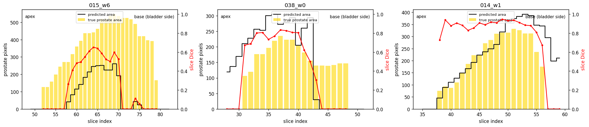

# 3D Improved U-Net for Prostate Segmentation on HipMRI

**Author:** Harfateh Shergill (s50082083)

> Work in progress. Sections marked *TODO* are filled in as experiments complete.

## Problem and algorithm

*TODO: one paragraph on the problem (prostate radiotherapy contouring) and one paragraph on how the 3D Improved U-Net works, with an architecture figure.*

## Feasibility review

### 1. User need, scope and acceptance criteria

**User:** a radiotherapy planner who reviews and adjusts draft contours of the prostate and nearby organs at risk (bladder, rectum) on pelvic MR. The tool proposes a 3D draft contour to save contouring time. The planner always reviews it; it never goes to treatment unchecked.

**Scope:** automatic 6-class segmentation (background, body, bone, bladder, rectum, prostate) of the CSIRO HipMRI 3D volumes. The question is whether 3D context reduces the errors that matter clinically: base/apex slice failures and leakage into rectum or bladder. Out of scope: other organs, other scanners, clinical deployment.

**Acceptance criteria** (all on held-out test patients)

1. Mean prostate Dice ≥ 0.7, scored at the original 256×256×128 resolution.
2. Prostate Dice on base and apex slices reported separately for the 3D model and both 2D baselines, with the 3D–2D difference stated.
3. Prostate voxels predicted inside ground-truth rectum or bladder reported per test case, plus HD95 in mm.
4. 3D training fits a 16 GB GPU (Colab T4) at batch size ≥ 1; peak VRAM and per-volume inference time reported for all models.
5. Zero patient overlap between train, validation and test, enforced by assertions in `dataset.py`.

### 2. Model choice and course concepts

**Chosen model:** 3D Improved U-Net (Isensee et al., 2018), Hard difficulty, on downsampled HipMRI 3D volumes. **Baselines:** a 2D U-Net (Ronneberger et al., 2015) and a 2D Improved U-Net, both trained on full-resolution axial slices of the same training patients. Their predictions are stacked back into volumes and scored exactly like the 3D model.

**Why these models**

- **Skip connections** carry fine spatial detail from encoder to decoder, needed for millimetre-scale boundaries.
- **Residual context modules** with InstanceNorm and LeakyReLU make the deeper network stable to train with small batches.
- **Deep supervision** adds segmentation outputs at lower decoder levels, giving the tiny prostate class gradient signal earlier.
- **3D convolutions** see neighbouring slices. That should help where 2D fails: base and apex slices, where the prostate is small and its edges are ambiguous within a single slice.
- **Soft Dice + cross-entropy loss** counters the extreme class imbalance (prostate = 0.1% of voxels).

**The trade-off being tested.** Voxels are nearly the same size in every direction (about 1.68 × 1.68 × 1.56 mm), so the 2D models do not suffer from thick slices. The 3D model gains context but must work at half resolution to fit in memory; 2D keeps full resolution. The comparison asks which matters more at the clinically risky boundaries.

### 3. Preliminary feasibility evidence

A resolution test shows the task is feasible at ×2 downsampling: shrinking and re-enlarging the true labels alone limits prostate Dice to 0.918, well above the 0.7 target.

**Data audit** (CSIRO *Labelled weekly MR images of the male pelvis*)

| Item | Finding |
| --- | --- |
| Volumes | 211 image/label pairs, all paired, none unparsed |
| Patients | 38; scans per patient min 1, median 8, max 8 |
| Volume shape | 256×256×128 (210 volumes); one at 256×256×144, cropped to 128 slices |
| Voxel spacing | in-plane 1.41–1.88 mm (152 volumes at 1.68), slice 1.56 mm |
| Labels | 0 background, 1 body, 2 bone, 3 bladder, 4 rectum, 5 prostate (confirmed visually) |
| Prostate | 0.1% of voxels; present in 100% of scans |
| Planned split | by patient, 26 / 6 / 6 (train / val / test) |

**Resolution ceiling.** Labels were downsampled with nearest-neighbour, upsampled back, and compared with the originals on 20 random scans. This is the best prostate Dice a perfect model could reach at each resolution:

| Downsample | Volume size | Mean Dice ceiling | Worst case |
| --- | --- | --- | --- |
| ×2 | 128×128×64 | 0.918 | 0.871 |
| ×4 | 64×64×32 | 0.790 | 0.708 |

×2 is chosen; ×4 would leave almost no margin above the 0.7 target.

### 4. Risks, budget and fallback

The main risk is compute: GPU time is limited to a 29 h EAIT GPU Lab quota, so development and smoke tests run on free Colab and only full training runs use the lab.

| Risk | Mitigation or fallback |
| --- | --- |
| Rangpur access delayed | Not blocking: full runs use the EAIT GPU Lab, development uses Colab; Rangpur becomes overflow once access arrives |
| 3D model doesn't fit in GPU memory | Batch size 1–2, mixed precision, 8–16 base filters, patch training with sliding-window inference |
| Prostate class ignored (0.1% of voxels) | Soft Dice + cross-entropy, prostate class weighting, sampling biased toward prostate regions |
| Patient leakage via repeat weekly scans | Split by patient ID only; assertions fail the run on any overlap |
| Small test set (6 patients) makes scores noisy | Report per-patient Dice with mean ± std; average each patient's scans before averaging across patients |
| 3D below Dice 0.7 by deadline | Submit the 2D Improved U-Net (Normal, capped at 15/20) as the chosen model, with the 2D U-Net as its baseline |
| Fallback needs the course 2D data (`keras_slices_data`), not yet obtained | Request it from the course now, before it is needed |

**Compute budget (estimates; replaced by measured times after each run):** EAIT Virtual GPU Lab, 29 h quota on L4 / A10G / L40S GPUs, used only for full training runs: 2D U-Net ≈ 1–2 h, 2D Improved U-Net ≈ 2 h, 3D Improved U-Net ≈ 10–15 h, leaving ≈ 10 h in reserve for reruns. Free Colab (T4) handles development, checks and smoke tests; Rangpur is overflow. Checkpoints are saved every epoch and results are backed up after each run, because lab instances may not keep files between sessions.

**Next experiment:** write `dataset.py` (patient-level split and loader), then train the 2D U-Net baseline on full-resolution axial slices of the 26 training patients, recording training loss, validation prostate Dice, peak VRAM and time per epoch to replace the estimates above.

## Dependencies and reproducibility

*TODO: exact package versions (`requirements.txt`), random seed (42), commands to reproduce each result.*

## Data, preprocessing and splits

**Data.** CSIRO *Labelled weekly MR images of the male pelvis* (HipMRI): 211 MR volumes from 38 patients, each with a 6-class label volume (0 background, 1 body, 2 bone, 3 bladder, 4 rectum, 5 prostate). Most patients were scanned weekly, up to 8 times. The data is not included in this repository (licence CC BY-NC-ND 4.0).

**Preprocessing** (`dataset.py`, run once and cached as `.npy`):

1. Each image is paired with its label by patient and week, parsed from the file names (211 pairs, none unmatched).
2. The slice axis is fixed at 128 slices. One volume (`019_w1`, 144 slices) is centre-cropped by 8 slices at each end; it belongs to a training patient, so validation and test data are untouched.
3. Each image is z-score normalised per volume (mean 0, standard deviation 1) so intensities are comparable across scans.
4. Volumes are stored as (slice, height, width) so each axial slice can be read directly from disk.

**Splits.** Patients, not scans, are split 26 / 6 / 6 into train / validation / test with a fixed seed (42). Repeat weekly scans of one patient are near-identical, so a scan-level split would leak test anatomy into training. Assertions in `split_patients` stop the run if any patient appears in two splits.

| Split | Patients | Scans | 2D slices |
| --- | --- | --- | --- |
| Train | 26 | 150 | 19,200 |
| Validation | 6 | 27 | 3,456 |
| Test | 6 | 34 | 4,352 |

Only 20.6% of training slices contain prostate, so 2D training samples slices with weights that make about half of each batch prostate-containing. Training-only augmentation: random left-right flip (applied identically to image and label) and mild intensity scaling and shifting.

## Usage

*TODO: `train.py` and `predict.py` commands with example outputs.*

## Results

### 2D U-Net baseline

Trained for 30 epochs on the 26 training patients (Adam, learning rate 1e-3 with cosine decay, batch size 16, mixed precision). The checkpoint with the best validation prostate Dice (epoch 14) was evaluated once on the 6 test patients (34 scans). Dice is averaged over each patient's scans first, then across patients, so a patient with 8 scans counts the same as a patient with 1.

| Class | Test Dice (mean ± std) | Test IoU |
| --- | --- | --- |
| Body | 0.972 ± 0.017 | 0.946 |
| Bone | 0.913 ± 0.025 | 0.841 |
| Bladder | 0.851 ± 0.167 | 0.772 |
| Rectum | 0.883 ± 0.031 | 0.792 |
| **Prostate** | **0.730 ± 0.113** | **0.588** |

Validation prostate Dice reached ~0.82 by epoch 7 and stayed flat while the training loss kept falling, a sign of mild overfitting; the best checkpoint is used, so more epochs would not help this model.

**Per-patient test results.** Two patients account for most of the gap between validation (0.82) and test (0.73):

| Test patient | Scans | Prostate Dice | Bladder Dice |
| --- | --- | --- | --- |
| 033 | 8 | 0.865 | 0.953 |
| 039 | 8 | 0.843 | 0.937 |
| 014 | 8 | 0.773 | 0.937 |
| 037 | 1 | 0.730 | 0.952 |
| 038 | 1 | 0.587 | 0.488 |
| 015 | 8 | 0.580 | 0.838 |

Averaged per scan instead of per patient, prostate Dice would be 0.759; the per-patient mean is reported because patient 015's eight weak scans should count as one patient, not eight.

**Measured cost:** 7,762,630 parameters, 1.72 GB peak training VRAM, 213 s per epoch on a Colab T4 (~1.8 h for 30 epochs).

### Preliminary 2D error analysis

Slice-by-slice prostate Dice for three test scans shows the 2D model's errors concentrate at the ends of the gland (apex on the left, base on the bladder side on the right; slices are 1.56 mm apart):

| Scan | Middle slices | Apex | Base | What the missed prostate was predicted as |
| --- | --- | --- | --- | --- |
| 014_w1 | Dice 0.85–0.95 | first slice 0.73 | 3 extra slices past the base (~4.7 mm) | – |
| 038_w0 | Dice 0.7–0.85, over-segmented | 3 false slices below the apex | last 6 slices missed (~9.4 mm) | base: body 84%, bladder 13% |
| 015_w6 | about half the area found | first 6 slices missed | base third almost entirely missed | apex: body 100%; base: background 73% |

Three failure modes appear: (1) the apex blends into the surrounding pelvic-floor tissue and is predicted as body; (2) the base is confused with the bladder neck; (3) in patient 015, whose gland is unusually large (28 slices) and dark, the model labels prostate as background, an anatomically impossible hole inside the pelvis. Modes 1 and 2 are where 3D context should help; mode 3 may be driven by intensity rather than context. These observations come from three scans and are tested across all test patients in the evaluation below.

*TODO: 2D and 3D Improved U-Net results, base/mid/apex Dice and extent error for all models, leakage, HD95, resource profiling.*

## Failure case autopsy

*TODO: 3–5 cases with figures.*

## Recommendation to the project manager

*TODO*

## Artificial Intelligence Usage Disclosure

*TODO: tools used, what they helped with, and how outputs were verified.*

## References

1. O. Ronneberger, P. Fischer, and T. Brox, "U-Net: Convolutional networks for biomedical image segmentation," MICCAI, 2015.
2. F. Isensee, P. Kickingereder, W. Wick, M. Bendszus, and K. H. Maier-Hein, "Brain tumor segmentation and radiomics survival prediction: Contribution to the BRATS 2017 challenge," 2018.
3. CSIRO, "Labelled weekly MR images of the male pelvis," doi:10.25919/45t8-p065.
