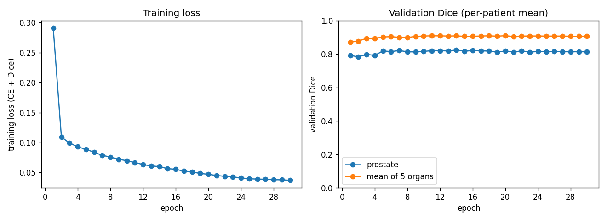
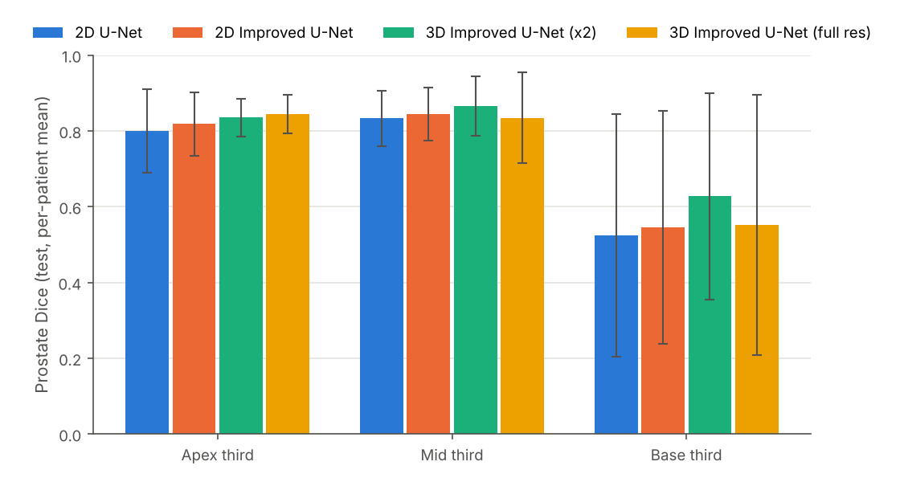
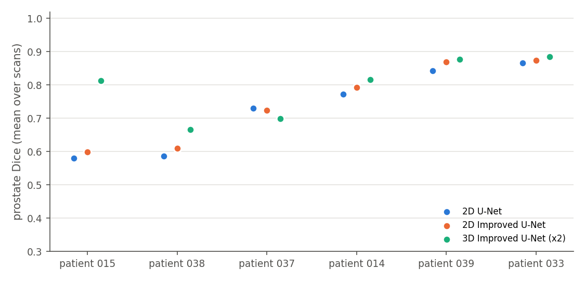
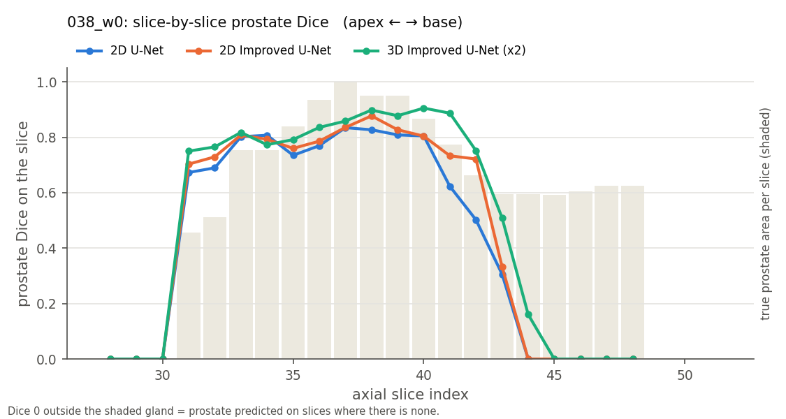
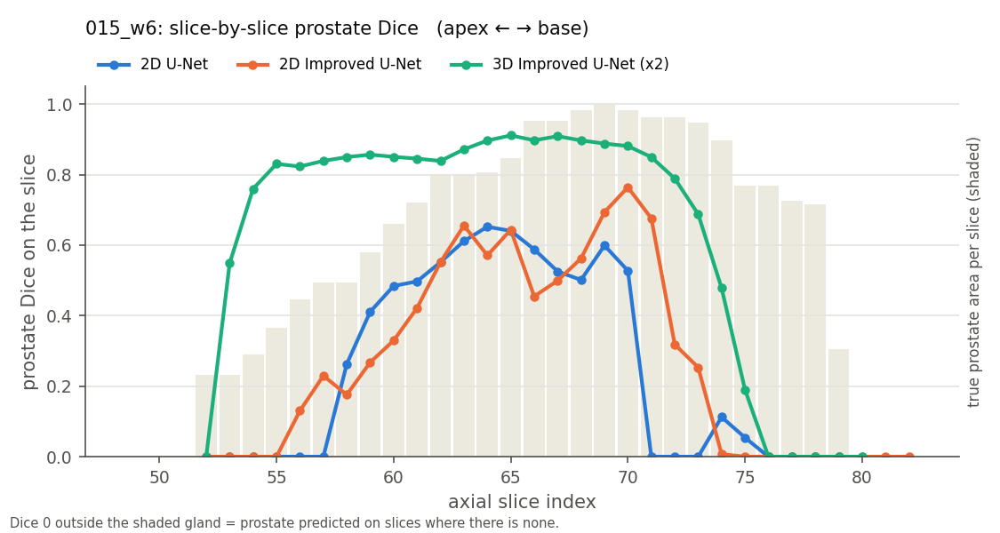
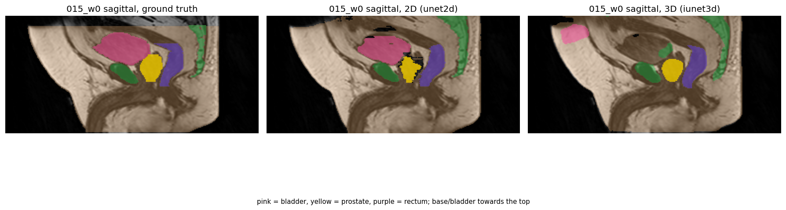
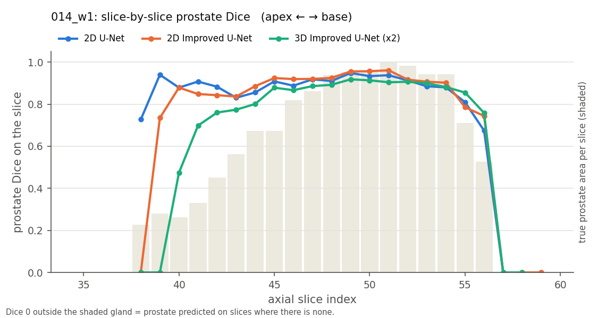

# 3D Improved U-Net for Prostate Segmentation on HipMRI

**Author:** Harfateh Shergill (s50082083)

> Work in progress. Sections marked *TODO* are filled in as experiments complete.

## Problem and algorithm

**Problem.** Before prostate radiotherapy, a planner contours the prostate (the treatment target) and the nearby organs at risk, the bladder and rectum, on MR images, slice by slice. Under-contouring risks leaving tumour untreated; over-contouring irradiates the rectal and bladder walls. This project segments six classes (background, body, bone, bladder, rectum, prostate) in 3D pelvic MR volumes to produce draft contours for a planner to review, and investigates the course's open question: does 3D context fix the clinically dangerous errors at the ends of the gland and at organ boundaries, or does it only improve easy central slices at extra cost?

**Algorithm.** The chosen model is a 3D Improved U-Net (Isensee et al., 2018). Like a U-Net, an encoder repeatedly halves the volume to learn *what* is present and a decoder enlarges it back to locate *where*, with skip connections carrying fine detail across. The Improved U-Net adds pre-activation residual *context modules* (instance normalisation, LeakyReLU, dropout) in the encoder, stride-2 convolutions for downsampling, *localisation modules* after each skip connection, and *deep supervision*: segmentation outputs from three decoder levels are upsampled and summed so the deeper layers get a direct training signal. All convolutions are 3x3x3, so every layer sees neighbouring slices. It is compared with two baselines on axial 2D slices: a standard 2D U-Net (Ronneberger et al., 2015) and a 2D Improved U-Net, which share the same architecture ideas but see one slice at a time.

*TODO: architecture figure.*

## Feasibility review

### 1. User need, scope and acceptance criteria

**User:** a radiotherapy planner who reviews and adjusts draft contours of the prostate and nearby organs at risk (bladder, rectum) on pelvic MR. The tool proposes a 3D draft contour to save contouring time. The planner always reviews it; it never goes to treatment unchecked.

**Scope:** automatic 6-class segmentation (background, body, bone, bladder, rectum, prostate) of the CSIRO HipMRI 3D volumes. The question is whether 3D context reduces the errors that matter clinically: base/apex slice failures and leakage into rectum or bladder. Out of scope: other organs, other scanners, clinical deployment.

**Acceptance criteria** (all on held-out test patients)

1. Mean prostate Dice ≥ 0.7, scored at the original 256×256×128 resolution.
2. Prostate Dice on base and apex slices reported separately for the 3D model and both 2D baselines, with the 3D–2D difference stated.
3. Prostate voxels predicted inside ground-truth rectum or bladder reported per test case, plus HD95 in mm.
4. 3D training fits a 16 GB GPU (Colab T4) at batch size ≥ 1; peak VRAM and per-volume inference time reported for all models.
5. Zero patient overlap between train, validation and test, enforced by assertions in `dataset.py`.

### 2. Model choice and course concepts

**Chosen model:** 3D Improved U-Net (Isensee et al., 2018), Hard difficulty, on downsampled HipMRI 3D volumes. **Baselines:** a 2D U-Net (Ronneberger et al., 2015) and a 2D Improved U-Net, both trained on full-resolution axial slices of the same training patients. Their predictions are stacked back into volumes and scored exactly like the 3D model.

**Why these models**

- **Skip connections** carry fine spatial detail from encoder to decoder, needed for millimetre-scale boundaries.
- **Residual context modules** with InstanceNorm and LeakyReLU make the deeper network stable to train with small batches.
- **Deep supervision** adds segmentation outputs at lower decoder levels, giving the tiny prostate class gradient signal earlier.
- **3D convolutions** see neighbouring slices. That should help where 2D fails: base and apex slices, where the prostate is small and its edges are ambiguous within a single slice.
- **Soft Dice + cross-entropy loss** counters the extreme class imbalance (prostate = 0.1% of voxels).

**The trade-off being tested.** Voxels are nearly the same size in every direction (about 1.68 × 1.68 × 1.56 mm), so the 2D models do not suffer from thick slices. The 3D model gains context but must work at half resolution to fit in memory; 2D keeps full resolution. The comparison asks which matters more at the clinically risky boundaries.

### 3. Preliminary feasibility evidence

A resolution test shows the task is feasible at ×2 downsampling: shrinking and re-enlarging the true labels alone limits prostate Dice to 0.918, well above the 0.7 target.

**Data audit** (CSIRO *Labelled weekly MR images of the male pelvis*)

| Item | Finding |
| --- | --- |
| Volumes | 211 image/label pairs, all paired, none unparsed |
| Patients | 38; scans per patient min 1, median 8, max 8 |
| Volume shape | 256×256×128 (210 volumes); one at 256×256×144, cropped to 128 slices |
| Voxel spacing | in-plane 1.41–1.88 mm (152 volumes at 1.68), slice 1.56 mm |
| Labels | 0 background, 1 body, 2 bone, 3 bladder, 4 rectum, 5 prostate (confirmed visually) |
| Prostate | 0.1% of voxels; present in 100% of scans |
| Planned split | by patient, 26 / 6 / 6 (train / val / test) |

**Resolution ceiling.** Labels were downsampled with nearest-neighbour, upsampled back, and compared with the originals on 20 random scans. This is the best prostate Dice a perfect model could reach at each resolution:

| Downsample | Volume size | Mean Dice ceiling | Worst case |
| --- | --- | --- | --- |
| ×2 | 128×128×64 | 0.918 | 0.871 |
| ×4 | 64×64×32 | 0.790 | 0.708 |

×2 is chosen; ×4 would leave almost no margin above the 0.7 target.

### 4. Risks, budget and fallback

The main risk is compute: GPU time is limited to a 29 h EAIT GPU Lab quota, so development and smoke tests run on free Colab and only full training runs use the lab.

| Risk | Mitigation or fallback |
| --- | --- |
| Rangpur access delayed | Not blocking: full runs use the EAIT GPU Lab, development uses Colab; Rangpur becomes overflow once access arrives |
| 3D model doesn't fit in GPU memory | Batch size 1–2, mixed precision, 8–16 base filters, patch training with sliding-window inference |
| Prostate class ignored (0.1% of voxels) | Soft Dice + cross-entropy, prostate class weighting, sampling biased toward prostate regions |
| Patient leakage via repeat weekly scans | Split by patient ID only; assertions fail the run on any overlap |
| Small test set (6 patients) makes scores noisy | Report per-patient Dice with mean ± std; average each patient's scans before averaging across patients |
| 3D below Dice 0.7 by deadline | Submit the 2D Improved U-Net (Normal, capped at 15/20) as the chosen model, with the 2D U-Net as its baseline |
| Fallback needs the course 2D data (`keras_slices_data`), not yet obtained | Request it from the course now, before it is needed |

**Compute budget (estimates; replaced by measured times after each run):** EAIT Virtual GPU Lab, 29 h quota on L4 / A10G / L40S GPUs, used only for full training runs: 2D U-Net ≈ 1–2 h, 2D Improved U-Net ≈ 2 h, 3D Improved U-Net ≈ 10–15 h, leaving ≈ 10 h in reserve for reruns. Free Colab (T4) handles development, checks and smoke tests; Rangpur is overflow. Checkpoints are saved every epoch and results are backed up after each run, because lab instances may not keep files between sessions.

**Next experiment:** write `dataset.py` (patient-level split and loader), then train the 2D U-Net baseline on full-resolution axial slices of the 26 training patients, recording training loss, validation prostate Dice, peak VRAM and time per epoch to replace the estimates above.

## Dependencies and reproducibility

Python 3.10+, PyTorch, nibabel, NumPy, SciPy, matplotlib, tqdm (`requirements.txt`). Runs used Google Colab (NVIDIA T4) and the EAIT Virtual GPU Lab (NVIDIA L4, PyTorch 2.11.0+cu128 in a virtual environment, because the lab's shared environment failed to load cuDNN). *TODO: pin exact versions.* All runs use seed 42; the patient split is regenerated identically from that seed and saved as `split.json` in each run folder.

## Data, preprocessing and splits

**Data.** CSIRO *Labelled weekly MR images of the male pelvis* (HipMRI): 211 MR volumes from 38 patients, each with a 6-class label volume (0 background, 1 body, 2 bone, 3 bladder, 4 rectum, 5 prostate). Most patients were scanned weekly, up to 8 times. The data is not included in this repository (licence CC BY-NC-ND 4.0).

**Preprocessing** (`dataset.py`, run once and cached as `.npy`):

1. Each image is paired with its label by patient and week, parsed from the file names (211 pairs, none unmatched).
2. The slice axis is fixed at 128 slices. One volume (`019_w1`, 144 slices) is centre-cropped by 8 slices at each end; it belongs to a training patient, so validation and test data are untouched.
3. Each image is z-score normalised per volume (mean 0, standard deviation 1) so intensities are comparable across scans.
4. Volumes are stored as (slice, height, width) so each axial slice can be read directly from disk.

**Splits.** Patients, not scans, are split 26 / 6 / 6 into train / validation / test with a fixed seed (42). Repeat weekly scans of one patient are near-identical, so a scan-level split would leak test anatomy into training. Assertions in `split_patients` stop the run if any patient appears in two splits.

| Split | Patients | Scans | 2D slices |
| --- | --- | --- | --- |
| Train | 26 | 150 | 19,200 |
| Validation | 6 | 27 | 3,456 |
| Test | 6 | 34 | 4,352 |

Only 20.6% of training slices contain prostate, so 2D training samples slices with weights that make about half of each batch prostate-containing. Training-only augmentation: random left-right flip (applied identically to image and label) and mild intensity scaling and shifting.

**3D input.** The 3D model receives whole volumes downsampled x2 in every direction (128x256x256 to 64x128x128; trilinear for images, nearest-neighbour for labels). Its predictions are upsampled back and scored against the original full-resolution labels, exactly like the 2D models. Section 3 of the feasibility review shows x2 downsampling alone limits prostate Dice to about 0.92.

## Usage

```bash
# Train (each run saves best.pt, last.pt, history.json, curves.png, split.json, test_metrics.json)
python train.py --data-root DATA --cache-dir CACHE --out-dir RUNS/unet2d  --model unet2d  --epochs 30
python train.py --data-root DATA --cache-dir CACHE --out-dir RUNS/iunet2d --model iunet2d --epochs 15 --lr 5e-4
python train.py --data-root DATA --cache-dir CACHE --out-dir RUNS/iunet3d --model iunet3d --epochs 150 --batch-size 2 --lr 5e-4
# add --resume to continue an interrupted run from last.pt

# Predict: per-class Dice and 4-panel figures for test scans
python predict.py --run-dir RUNS/iunet3d --cache-dir CACHE --num-cases 3

# Evaluate all models: choose check thresholds on validation, then report on test
python evaluate.py --runs-dir RUNS --cache-dir CACHE --out-dir RUNS/eval_val --split val --calibrate
python evaluate.py --runs-dir RUNS --cache-dir CACHE --out-dir RUNS/evaluation --thresholds RUNS/eval_val/thresholds.json
```

## Results

All numbers are on the 6 held-out test patients (34 scans), at full resolution, averaged over each patient's scans first and then mean ± std across patients. Produced by `evaluate.py`.

### Models trained

| Model | Input | Parameters | Epochs (best) | Optimiser | GPU |
| --- | --- | --- | --- | --- | --- |
| 2D U-Net (baseline) | 256x256 axial slices, batch 16 | 7,762,630 | 30 (14) | Adam 1e-3, cosine decay | Colab T4 |
| 2D Improved U-Net (baseline) | 256x256 axial slices, batch 16 | 2,776,834 | 15 (6) | Adam 5e-4, cosine decay | Lab L4 |
| **3D Improved U-Net (chosen)** | 64x128x128 volumes (x2), batch 2 | 8,279,074 | 150 (97) | Adam 5e-4, cosine decay | T4 (epochs 1–118), L4 (119–150) |

All use soft Dice + cross-entropy loss and mixed precision; the checkpoint with the best validation prostate Dice is tested once.



### Overall Dice

| Class | 2D U-Net | 2D Improved U-Net | 3D Improved U-Net |
| --- | --- | --- | --- |
| **Prostate** | 0.730 ± 0.113 | 0.745 ± 0.111 | **0.793 ± 0.083** |
| Bladder | **0.851 ± 0.167** | 0.746 ± 0.243 | 0.686 ± 0.356 |
| Rectum | **0.883 ± 0.031** | 0.865 ± 0.043 | 0.868 ± 0.028 |
| Bone | **0.913 ± 0.025** | 0.910 ± 0.026 | 0.883 ± 0.036 |
| Body | **0.972 ± 0.017** | 0.971 ± 0.019 | 0.962 ± 0.025 |

The 3D model meets the project target (prostate Dice ≥ 0.7). Most of its prostate gain comes from 3D context rather than the improved architecture: 2D U-Net to 2D Improved U-Net adds +0.015, 2D Improved to 3D Improved adds +0.048. The other organs are slightly worse in 3D, consistent with its half-resolution input, and the bladder fails badly for one patient (see the autopsy).

### Where along the gland: the core dilemma result

The true prostate's slice extent is split into thirds; the base is the end next to the bladder.

| Model | Apex Dice | Mid Dice | Base Dice | HD95 (mm) |
| --- | --- | --- | --- | --- |
| 2D U-Net | 0.800 ± 0.111 | 0.833 ± 0.073 | 0.524 ± 0.320 | 8.5 ± 2.7 |
| 2D Improved U-Net | 0.818 ± 0.084 | 0.844 ± 0.070 | 0.545 ± 0.307 | 11.9 ± 10.6 |
| 3D Improved U-Net | **0.835 ± 0.050** | **0.866 ± 0.079** | **0.627 ± 0.273** | **7.4 ± 4.1** |



The base is by far the weakest region for every model and varies enormously between patients. 3D context helps most exactly there (+0.10 over the 2D U-Net, against about +0.03 at the apex and middle) but does not solve it.

| Model | Apex extent (mm) | Base extent (mm) | Leak into bladder (mL) | Leak into rectum (mL) |
| --- | --- | --- | --- | --- |
| 2D U-Net | +4.7 ± 4.7 | 0.0 ± 5.1 | 0.63 ± 0.95 | 0.02 ± 0.03 |
| 2D Improved U-Net | +4.5 ± 3.7 | +5.7 ± 11.3 | 0.91 ± 1.34 | 0.02 ± 0.05 |
| 3D Improved U-Net | **+1.2 ± 2.7** | +1.0 ± 5.1 | **0.37 ± 0.27** | 0.02 ± 0.05 |

Extent error is how far the predicted gland ends beyond (+) or short of (−) the true apex or base. Both 2D models run on average about 3 slices (≈ 4.7 mm) past the apex; the 3D model ends close to the true apex and leaks least into the bladder. Rectal leakage is negligible for all models.



3D improves the prostate for 5 of 6 test patients; the largest gain is on the hardest patient (015: 0.58 to 0.81). The one decrease (037, a single scan) is small.

### Resources

| Model | Inference per scan | Peak inference VRAM | Training per epoch | Peak training VRAM |
| --- | --- | --- | --- | --- |
| 2D U-Net | 0.51 s | 1.25 GB | 213 s (T4) | 1.73 GB |
| 2D Improved U-Net | 0.38 s | 0.94 GB | 85 s (L4) | 1.31 GB |
| 3D Improved U-Net (x2) | **0.12 s** | **0.48 GB** | **26 s (T4)** | 2.11 GB |

Inference was timed on one GPU for all models. Contrary to the expectation that 3D costs 5–10x more, at x2 downsampling the 3D model is the cheapest to run and, on the same T4, trains faster per epoch than full-resolution 2D (about 1.1 h for 150 epochs against 1.8 h for 30). Its real cost is resolution, not compute.

*TODO: full-resolution 3D result; anatomy checks calibrated on validation.*

## Failure case autopsy

**1. The base of the gland (all models, most patients).** In `038_w0` all three models agree in the middle of the gland and all three miss the last five base slices (about 7.8 mm). The 2D U-Net predicted those true-prostate voxels as body tissue (84%) and bladder (13%). The base meets the bladder neck, which has similar intensity on these images. Clinically this is under-contouring of the target, a recurrence risk.



**2. Unusual image contrast breaks each model differently (patient 015).** Patient 015's gland is large (28 slices against about 18 for others) and dark on MR. The 2D models label much of it as background, an anatomically impossible hole inside the pelvis (2D U-Net prostate Dice 0.35 on `015_w6`; across the base third, background 73%). The 3D model follows the gland across slices and recovers it (0.73 on `015_w6`, 0.81 for the patient), but on all 8 of this patient's scans it misplaces the bladder: its predicted bladder is 98% body tissue, centred about 105 mm anterior and 23 mm superior to the true bladder, in the abdominal wall (bladder Dice 0.000–0.035).




**3. The cost of half resolution at the apex (`014_w1`).** On the thin apex slices the full-resolution 2D U-Net scores 0.73–0.94, while the 3D model misses the first two slices entirely and reaches 0.47 on the third: a small apex tip is lost when the volume is downsampled x2.



**4. Holes and fragments in 2D predictions.** A check for background enclosed inside the body (never present in the ground truth) fires on all 34 2D U-Net test scans at a 1 mL threshold: small holes are pervasive in slice-wise predictions, and large ones (patient 015) are catastrophic. The 2D Improved U-Net also splits the prostate into several pieces on 11 scans. *TODO: thresholds calibrated on validation and the resulting flag rates.*

*TODO: one more case from the full-resolution 3D comparison.*

## Recommendation to the project manager

*Draft; to be finalised after the full-resolution 3D run and the calibrated checks.*

1. **Use the 3D Improved U-Net (x2) to draft prostate contours.** It is the most accurate on the target organ (Dice 0.79 against 0.73), has the tightest boundary (HD95 7.4 mm), ends closest to the true apex, leaks least into the bladder, and is also the cheapest model to run (0.12 s and 0.5 GB per scan).
2. **Always review the base of the gland manually.** No model is reliable there (base Dice 0.52–0.63 with a spread of ±0.3), and errors are under-contouring next to the bladder neck.
3. **Do not use the 3D model's bladder contour without review.** It failed completely for one test patient with unusual anatomy; the 2D U-Net's bladder is more dependable (0.85 against 0.69).
4. **Expect small apex tips to be missed at half resolution;** check the first apex slices.
5. **3D context is worth it here,** but not for the reason usually assumed: at x2 downsampling it costs less compute than full-resolution 2D. What it costs is resolution, which shows up at thin structures.

## Artificial Intelligence Usage Disclosure

*TODO: complete in your own words from your AI usage log.* Suggested structure:

- **Tool:** Claude (Anthropic).
- **Used for:** project planning; data-audit and resolution-test notebooks; drafting the feasibility review; generating the code for the data pipeline, models, training, prediction and evaluation; explanations of methods; drafting README text.
- **How outputs were verified:** each code step was committed separately after a check on the real data (patient counts and split, preprocessing statistics, label overlays, model output shapes and parameter counts, loss and metric sanity tests, re-scoring a saved result); training runs were inspected through learning curves; evaluation metrics were unit-tested on synthetic cases with known answers; figures were inspected for anatomical plausibility.
- **What I did myself:** *TODO.*

## References

1. O. Ronneberger, P. Fischer, and T. Brox, "U-Net: Convolutional networks for biomedical image segmentation," MICCAI, 2015.
2. F. Isensee, P. Kickingereder, W. Wick, M. Bendszus, and K. H. Maier-Hein, "Brain tumor segmentation and radiomics survival prediction: Contribution to the BRATS 2017 challenge," 2018.
3. CSIRO, "Labelled weekly MR images of the male pelvis," doi:10.25919/45t8-p065.
